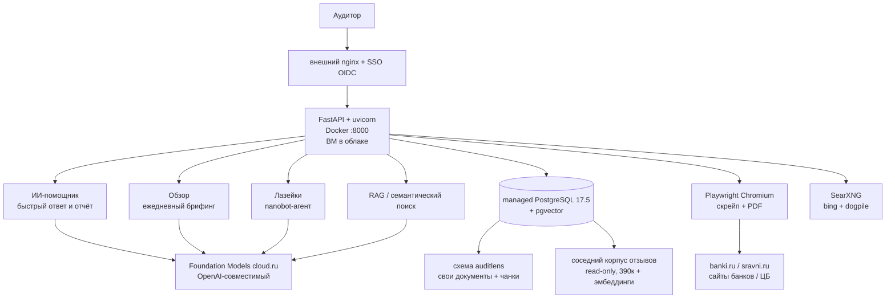
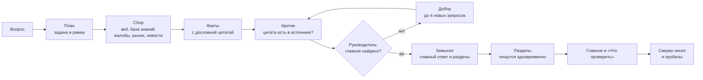

# Архитектура AuditLens

> Документ описывает систему **как она реально развёрнута** в облаке Cloud.ru по состоянию на 15.07.2026.
> Числа, имена функций и значения env сверены с кодом и с прод-инстансом.
> Где документированное расходится с фактическим — это явно отмечено.

---

## 1. Что это

**AuditLens** — платформа внутреннего аудита розничных банковских продуктов. Аудитор задаёт вопрос на естественном языке («сравни ипотеку Сбера с рынком», «что не так с начислением процентов по кредиткам») и получает **обоснованный отчёт со ссылками на источники**, а не правдоподобный текст от языковой модели.

Ключевое отличие от «LLM + поиск»: **числа считает детерминированный код, LLM только формулирует**. Всё, что модель могла бы выдумать, либо сверяется с фактами регуляркой, либо вообще не доверяется модели — графики и сравнительные таблицы строятся из `bundle.facts`, минуя LLM.

Закрытый корпоративный контур, боевых данных в нём нет. TLS и аутентификация терминируются на внешнем SSO-прокси (OIDC) — приложение живёт за периметром.

---

## 2. Карта системы



---

## 3. Развёртывание в облаке (Cloud.ru)

Самая содержательная часть: почти все нетривиальные решения продиктованы **ограничениями корпоративного облака**, а не academic-инженерией.

### 3.1 Периметр

| Компонент | Как есть |
|---|---|
| ВМ | Ubuntu 24.04, 4vCPU/8GB, регион ru-moscow-1 (движок Huawei) |
| Приложение | один контейнер `auditlens-app`, `--network host`, порт `:8000` |
| Доступ | внешний nginx + **SSO (OIDC)**: TLS и аутентификация терминируются на прокси |
| БД | **managed PostgreSQL 17.5** + pgvector, схема `auditlens` |
| LLM + эмбеддинги | **Foundation Models cloud.ru**, `https://foundation-models.api.cloud.ru/v1/` (OpenAI-совместимый) |
| Снаружи | порт закрыт security-группой; разработчик ходит SSH-туннелем |

Запуск (durable-паттерн):

```bash
docker run -d --name auditlens-app \
  --network host --init --restart unless-stopped \
  --env-file ~/auditlens/.env \
  -v $WS:$WS \
  auditlens:prod        # entrypoint: serve
```

### 3.2 Четыре решения, продиктованные облаком

**① «Vector-free» фаза миграций.**
Роль приложения в managed-PG — **не суперюзер**, `CREATE EXTENSION vector` выполняет только команда инфраструктуры облака и, возможно, позже первого наката. Блокироваться на этом нельзя. Решение — расщепление миграции:

- `CREATE EXTENSION` в `005_rag_foundation.sql` обёрнут в `DO $$ … EXCEPTION WHEN insufficient_privilege THEN RAISE NOTICE` — миграция не падает;
- вектор-колонка `document_chunk.embedding vector(1024)` и HNSW-индекс вынесены в **`migrations/ensure_vector.sql`**, который применяется на **каждый** `migrate` и **не журналируется** в `schema_migrations` — то есть до-создаёт вектор-объекты в тот момент, когда расширение наконец появится.

**② Экономия ~2.5 ГБ образа — архитектурой, а не упаковкой.**
`torch` / `sentence-transformers` не «вырезаны», а вынесены в optional-extra `local-embeddings`. Их отсутствие компенсировано тем, что **bge-m3 уже доступен как сервис** в Foundation Models → в проде `EMBEDDING_MODE=api`, и torch вообще не импортируется.

**③ `--init` (tini) — обязательный флаг, а не косметика.**
`entrypoint.sh` делает `exec uvicorn` → uvicorn становится PID 1 (нужно для корректного SIGTERM). Но PID 1 обязан реапить осиротевшие процессы, а Playwright порождает Chromium **на каждый** скрейп и PDF-экспорт. Без tini зомби копятся и переполняют память.

**④ Эмпирика вместо документации: поиск сузили по факту замеров.**
С IP дата-центра cloud.ru из ~8 движков SearXNG выживают ровно **два — bing и dogpile** (~18 результатов/запрос). Google, Yandex, Brave, DDG, Qwant, Mojeek, Startpage отдают капчу. Конфиг не «на всякий случай широкий», а `keep_only: [bing, dogpile]`.

### 3.3 Прочие детали периметра

- `/healthz` и `/readyz` зарегистрированы строго **до** catch-all `/{full_path:path}` SPA-фоллбэка — иначе фоллбэк вернул бы 200+HTML на health-пробу, и оркестратор считал бы мёртвое приложение живым.
- Доверие к CA Минцифры разное по клиентам: httpx получает бандл явно (`verify=CA_BUNDLE_PATH`), Chromium — грубым `--ignore-certificate-errors`.
- Идентичный bind-mount `-v $WS:$WS` (одинаковый путь внутри и снаружи) — вынужденно: `WORKSPACE_DIR` в `.env` содержит хостовый путь.

### 3.4 Честный разрыв: документированное ≠ фактическое

- `docs/DEPLOY_UVA.md` описывает `compose` + `run --rm app migrate` + журнал `schema_migrations`.
- **Реальность:** `docker run --network host`, а миграции накатываются **руками** через `docker cp` + `psql` — журнала на проде нет.
- Урок общего характера: если рядом с боевым инстансом остаётся забытый процесс со старым кодом, правки «уезжают в никуда» — стоит проверять, куда именно смотрит прокси.

---

## 4. Модели: пять тиров и рубильник комплаенса

### 4.1 Архитектура тиринга

Централизованного конфига моделей **нет**: `Settings` (`config.py`) не содержит ни одного LLM-поля, модели резолвятся через `os.getenv` в точках вызова. Де-факто реестр — `ai/analyst.py`.

Тиров **пять**: `FAST` / `SMART` / `INSIGHT` (есть геттеры) + `REASONING` / `ANALYST` (читаются напрямую в `research/*`).

Главное решение — **деградационная цепочка**: `явный аргумент → спец-env → SMART/FAST → LLM_MODEL_NAME → хардкод`. Докстринг `_tier_models()` прямо говорит: при отсутствии `LLM_MODEL_FAST` падаем на smart — **тиринг безопасно выключается**. Любой тир можно не задавать, и система схлопнется в одну модель без правки кода.

### 4.2 Что реально стоит на проде

```
LLM_BASE_URL   = https://foundation-models.api.cloud.ru/v1/
LLM_MODEL_NAME = DeepSeek V4 Pro            # базовая модель, запасная для остальных
```

| Тир | Модель на проде | Где применяется | Почему именно так |
|---|---|---|---|
| **FAST** | DeepSeek V4 Flash | короткие служебные вызовы: маршрутизация, подписи, отбор | вызовов много, решение простое — платить за рассуждение незачем |
| **SMART** | `openai/gpt-5.4-mini` | отчёт: выписка фактов и критик; быстрый агент (Hermes) | строгий JSON и точность цитат; сверху есть проверка цитаты кодом |
| **REASONING** | `openai/gpt-5.4` | отчёт: замысел (главный ответ и разделы), уточняющие вопросы, запасной план | несколько вызовов на прогон, но от них зависит, о чём будет отчёт |
| **ANALYST** | `anthropic/claude-opus-4.8` | отчёт: разделы, «Главное», «Что проверить», карточки | длинный связный текст строго по фактам |
| **PLAN** | `GPTR_PLAN_MODEL` (если не задана — REASONING) | отчёт: план и руководитель исследования (хватает ли собранного) | замер 11.11: Claude Opus 5.5 с малым усилием рассуждения дал лучшие запросы и темы за те же 7–8 с |
| **INSIGHT** | `anthropic/claude-sonnet-4.6` | разбор жалоб недели («Обзор», «Отзывы»), «Для вас» | несколько вызовов в сутки на всех пользователей — дорогую модель можно себе позволить |
| **NEWS S1** | `google/gemini-3-flash-preview` | «Обзор»: первичный отсев всего потока новостей пакетами | сотни материалов в сутки, нужна только релевантность 0–10 и тип |
| **NEWS S2 / HEAD** | `anthropic/claude-opus-4.8` | «Обзор»: оценка событий с полным текстом, формулировка передовицы | ценность для аудита решается здесь; выпуск один на всех |
| **JUDGE** | `openai/gpt-5.4` | независимый судья выпуска в «Пульсе» | другое семейство, чем у редакции, — не повторяет её ошибки |
| **REVIEWS** | Gemini 3 Flash + DeepSeek V4 Flash → V4 Pro → Sonnet 4.6 | разметка отзывов по кодификатору | две дешёвые модели пакетами, арбитр только при расхождении |
| — | `openai/gpt-4.1` | **мозг агента «Лазейки»** (`LOOPHOLE_NANOBOT_MODEL`) | вынужденно, см. 4.4 |

Эмбеддинги: **`BAAI/bge-m3`, 1024d, 512 токенов**, `EMBEDDING_MODE=api` через те же Foundation Models.

### 4.3 Рубильник «внутренний контур ↔ внешние модели»

В `.env.prod.example` прямым текстом: **«Внутренние модели (комплаентный дефолт). Внешние (gemini/claude/gpt) — по согласованию»** — и все пять тиров там выставлены в `openai/gpt-oss-120b`.

То есть архитектура спроектирована как **рубильник**: по умолчанию всё крутится на внутренней модели контура, а качество поднимается сменой пяти строк env — после согласования с командой инфраструктуры. На текущем проде рубильник переведён на внешние модели (таблица выше). **Смена модели = env + рестарт, без правки кода** (константы вычисляются на импорте).

### 4.4 Почему у «Лазеек» отдельная модель

Агент «Лазеек» построен на **nanobot-ai**, который строит tool-схемы в OpenAI-формате (list-типы, `default`, `items`). Gemini валидирует `function_declarations` строго и отвечает `400 INVALID_ARGUMENT: Proto field is not repeating` на стадии ответа — агент молча выдавал пустоту.

Поэтому `LOOPHOLE_NANOBOT_MODEL=openai/gpt-4.1` задан **только в прод-`.env`** (в репозитории его нет). Диагностировано эмпирически: с gpt-4.1 агент реально ходит по инструментам и даёт обоснованный ответ с источниками.

> **Урок для доклада:** OpenAI-совместимый эндпоинт ≠ OpenAI-совместимое поведение. Совместимость chat-completions не означает совместимости function-calling.

### 4.5 `reasoning_effort`: дёшево по умолчанию, дорого точечно

`_patch_client_reasoning_effort()` (`ai/llm_utils.py`) — **monkey-patch клиента**: подменяет `chat.completions.create` и подмешивает `extra_body={"reasoning_effort": …}` (прод: `low`). Патч не перетирает уже проставленный effort — на этом строится `deep_reasoning_extra()` (прод: `medium`), который точечно поднимает effort в **10 местах**: план, нарратив, критик, grounding, clarify.

Мотивация в докстринге: глобальный `low` — потому что частые nav-итерации агентов «жгут время», но немногочисленные reasoning-вызовы «от этого становятся плоскими».

Тот же патч чинит несовместимость: если в имени модели есть `gpt-5`, а `temperature ≠ 1` — параметр молча удаляется (GPT-5 поддерживает только дефолтную температуру, а пайплайн ставит `0.0` для детерминизма).

### 4.6 Тиринг внутри одного агента

`base_agent.py` объявляет **два** атрибута класса:

- `MODEL_TIER` — модель для **итераций** цикла (поиск/чтение/роутинг);
- `FINAL_MODEL_TIER` — модель для **финального извлечения** структуры.

У `researcher`: `loop=fast`, `final=smart` — «навигация быстрая, извлечение фактов сильное (точность чисел критична, плюс Critic перепроверяет)». У механических агентов (`regulatory`, `market`, `reviews`) — `fast`, у `ranking` — `smart`.

Выбор тира **протёк даже в лимит обрезки tool-результатов**: `read_url` → 18000 символов, поиск → 12000, с обоснованием «финальное извлечение идёт из истории сообщений, и потерянный кусок страницы = потерянный факт».

### 4.7 Толерантный JSON-парсер как плата за reasoning-модели

`_loose_json_loads()` — **8 последовательных стратегий** разбора: скан balanced top-level `{...}` с учётом строк/escape, срез markdown-fence, вычистка control-символов, снятие trailing comma, обрезка по последней сбалансированной скобке, починка чисел внутри `"data":[…]` (убирает `+`, пробелы, единицы «%/руб/млн», меняет запятую на точку), поэлементный разбор массива.

Причина в докстринге: «reasoning-leak, fences, trailing comma, числа» — прямое следствие ставки на reasoning-модели, которые подмешивают размышления в ответ.

---

## 5. ИИ-помощник: короткая справка и отчёт

Пользуются помощником только аудиторы банка, и оба вида ответа пишутся для них: ответ начинается с сути, каждое число — со ссылкой на источник, а то, чего найти не удалось, названо прямо.

| Вид ответа | Что это | Где код |
|---|---|---|
| Короткая справка | агент с инструментами AuditLens (жалобы, рынок, база знаний, новости, поиск); обычно меньше минуты | `ai/hermes_quick.py`, контейнер `hermes-al`, настройки в `deploy/hermes-al/` |
| Отчёт | исследование по шагам: план → сбор → факты с цитатами → проверка → письмо → сверка чисел; 3–5 минут | `research/gptr/stream.py` |

**Поле ввода одно, переключателя режимов нет.** Чем отвечать, решает модель-диспетчер (`ai/router.py`) по реплике и ходу разговора: `answer` — справка, `report` — отчёт, `reply` — реплика к уже данному ответу (новый сбор не нужен), `deck` — презентация по отчёту, который уже есть в разговоре. Слова аудитора главнее догадки («коротко» — справка, «нужен отчёт» — отчёт). Решение приходит клиенту первым событием `route` и показывается в ленте; человек меняет его одним нажатием («Нужен отчёт» во время справки, «Хватит короткого ответа» во время сбора отчёта) — тогда запрос уходит с явным `route` и `route_by: user`. Диспетчер не ответил за 7 секунд — работают правила по словам (`router.by_rules`). Маршрут и кто его выбрал пишутся в историю сообщения и событие `ai_run_end`.

Шаг подготовки (`POST /api/ai/clarify` с `auto: true`, `ai/clarify.prepare`) решает маршрут и полноту вопроса одновременно: уточняющие вопросы задаются только отчёту, справка их не ждёт. Уточнениям виден ход разговора, поэтому «а по ВТБ?» после отчёта не считается вопросом без предмета.

### 5.1 Шаги отчёта



### 5.2 План: какая задача и о ком речь

`research/v2/conductor.plan_research()` возвращает `ResearchPlan`. Кроме предмета и запросов в нём три поля, от которых зависит форма отчёта:

- `task` — что просят: `compare` (сравнить), `product` (всё о продукте), `complaints` (жалобы), `regulation` (нормы), `market_data` (рынок и цифры), `explain` (объяснить), `news` (разобрать новость), `check` (подготовка к проверке);
- `scope` — о ком: `sber`, `named` (названные организации), `market`, `none`;
- `checks` — нужен ли план проверки: `full` для жалоб, новости и подготовки к проверке, `short` (три–пять действий) для сравнения, продукта и норм, `none` для справки.

Модель может ошибиться, поэтому после неё работает `enforce_scope()` — обычный код: конкуренты, которых в вопросе нет и сравнения не просили, из плана убираются; вопрос о жалобах или продукте без названного банка считается вопросом о Сбере. До этой правки сравнение было зашито в пяти местах, и из 155 отчётов без конкурентов в вопросе 61 содержал раздел «Сбер против рынка».

Если основная модель плана не ответила, план строит запасная; если не ответила и она — `_fallback_plan()` по словам вопроса, без «четырёх банков по умолчанию».

### 5.3 Откуда берутся данные

1. **Веб.** Запросы плана идут через `rag/web_search.search()` (Яндекс через корпоративный шлюз, затем запасные поисковики). Страницы читает `gptr/scraper.py`; служебные страницы самих поисковиков отсеиваются, обёртки-переводчики разворачиваются до исходной страницы.
2. **Данные AuditLens** (`gptr/own_data.py`): база знаний (гибридный поиск по предмету вопроса, с проверкой, что документ действительно о нём), размеченные жалобы по теме вопроса, витрина «Рынок», «Аудит уязвимостей», новости, ссылки из самого вопроса. Жалобы и схемы подключаются к задачам аудита или когда о них спросили; к справке про историю или статистику — нет.
3. **Сохранённое не выдаётся за текущее.** Страницы, которые меняются без предупреждения (сайты банков, витрины агрегаторов — `own_data.is_volatile`), сначала читаются вживую; копия из базы знаний берётся, только когда страница не открылась, — с датой копии у источника и строкой в «Честных пробелах». Датированные документы (законы, акты регулятора, обзоры, новости) берутся из базы сразу и повторно из сети не читаются.

### 5.4 Факты и критик

`gptr/facts.py` выписывает из каждой страницы утверждения: предмет, характеристика, значение, единица, дата и **дословная цитата**. Выписчику передаётся предмет вопроса: страница про другое даёт пустой список, а не «похожие» числа (в прогоне 11.11 резервы страховщиков жизни были выписаны как «объём средств на металлических счетах»).

`gptr/critic.py` проверяет, что цитата есть на странице. Дешёвая проверка подтверждает дословные совпадения без модели; модель судит только остаток, с пределом по времени. Не подтверждённое снимается и считается в «Честных пробелах».

### 5.5 Руководитель исследования и добор

После первого сбора `gptr/lead.py` показывает сильной модели вопрос и указатель фактов с началом цитат и спрашивает одно: найдено ли главное. Если нет — она называет, чего не хватает, и даёт до четырёх новых запросов; читается до восьми новых страниц, факты из них проходят того же критика. Один круг, любая ошибка шага — отчёт пишется по собранному. Раньше 42 % резюме начинались с «нельзя» или «не найдено»: пробел честно называли, но закрыть не пытались.

### 5.6 Письмо

- **Замысел** (`gptr/brief.py`): одна модель видит все факты и решает главный ответ, тезисы и состав разделов. Разделы бывают готовые (условия, жалобы, сравнение, нормы, схемы, публикации) и свои — по теме вопроса, до четырёх.
- **Разделы** (`gptr/dossier.py`) пишутся одновременно, каждый — только по своим фактам и вокруг главного ответа.
- **«Главное»** и **«Что проверить»** пишутся последними, по готовому тексту. Короткий план проверки — только нумерованный список действий: код оставляет из ответа модели список и ничего больше.
- **Устойчивость.** Обрыв соединения повторяется до трёх раз. Отказ модели («Я Claude…») ловится в первых 600 знаках: раздел переписывается, после второго отказа — запасной моделью. Один несостоявшийся раздел не отменяет отчёт.
- **Карточки и графики** (`gptr/viz.py`): модель выбирает форму, числа подставляет код из фактов.

### 5.7 Сверка и пробелы

Каждое число отчёта сверяется с прочитанными страницами (`method: numbers_vs_read_pages`). Блок «Честные пробелы» (`gptr/gaps.py`) собирает то, что не найдено по плану, непрочитанные страницы с причиной и то, что снял критик.

### 5.8 Память исследования и продолжение

Проверенные факты отчёта сохраняются вместе с планом и сведениями об источниках (`gptr/memory.py`, таблица `report_memory`). Если следующий вопрос разговора — продолжение темы (решает планировщик, код страхует по предмету и организациям), отчёт начинает с этих фактов: общий сбор по сети не идёт, руководитель исследования добирает недостающее. Замер: 185 с против 309 с у первого отчёта.

Ограничения ради свежести: продолжается отчёт не старше трёх дней; сводки жалоб, рынка, схем и новостей из памяти не берутся — читаются заново; новая организация или другая тема — обычный сбор; в интерфейсе видно «продолжение прошлого отчёта» и есть «собрать заново».

### 5.9 Презентация

По готовому отчёту собирается презентация — один HTML-файл, который открывается без интернета (`gptr/deck_html.py`). Макет под конкретный отчёт рисует сильная модель в языке AuditLens; код упаковывает (шрифты внутри, холст 1920×1080 масштабируется под экран, листание, печать в PDF), удаляет скрипты и внешние адреса и тихо сверяет числа с текстом отчёта: неточное место правится точечной заменой текста, из макета ничего не вырезается и ничего к нему не приписывается. Три входа: кнопка «Презентация» под отчётом, реплика «сделай презентацию», вопрос, где презентацию просят сразу.

### 5.10 Что измеряется

- Обычная длительность этапов отчёта — медиана по недавним отчётам (`ai/report_stats.typical`, кэш на полчаса); пока своих отчётов мало — замер 11.11.2026.

- В сохранённом отчёте лежат тип задачи и время каждого шага; «Пульс» → «Качество ИИ» показывает, какие задачи ставят и на что уходит время (`ai/report_stats.py`).
- Регрессионный набор `ai/agent_eval.py`: вопросы быстрого режима и отчёта (D1–D16), включая «один продукт без конкурентов», «таблица по данным ЦБ» и «жалобы на конкретную услугу».
- Навыки быстрого агента раз в неделю проверяет `deploy/hermes-al/learn_gate.sh`: планка качества сама не опускается.

### 5.11 События потока

`route` (чем помощник решил отвечать и кто решил), `mode`, `notice`, `typical` (обычная длительность этапов — по ней интерфейс показывает «осталось примерно N минут»), `own_preview` (что уже нашлось в данных AuditLens: сюжеты жалоб, рынок, новости), `phase` (пять этапов, включая `verification` и `done`), `stage_status` (что происходит сейчас — показывается живой строкой; у письма — поле `section`), `plan` (с задачей, рамкой и признаком продолжения), `memory` (служебное: снимок фактов, клиенту не уходит), `files`, `sources`, `progress`, `facts_summary`, `outline`, `text`, `lead`, `viz`, `verification`, `gaps`, `report_title`, `report_saved`, `done` (с временем шагов).

### 5.12 Что осталось от прежних схем

`research/orchestrator.py` с окружением и агенты `research/v2/agents/` — прежние конвейеры; новый отчёт их не вызывает. Из `research/v2/` используется планировщик (`conductor.py`) и вспомогательные инструменты. Удаление старого кода — отдельная задача.

---

## 6. RAG и слой данных

### 6.1 Два корпуса, один вектор-контур

| Корпус | Что | Режим |
|---|---|---|
| `auditlens` (своя схема) | всё, что агент скачал: `document` → `document_chunk` c `embedding vector(1024)` + HNSW | rw, **15 120 чанков** |
| соседний корпус отзывов | **~390 тыс.** негативных отзывов (1–2★, 217 банков) + **готовые эмбеддинги** bge-m3 1024d с HNSW | **read-only** |

**Ключевое решение — не пересчитывать чужие эмбеддинги.** `rag/bankiru_reviews.py` открывает второй engine с `default_transaction_read_only=on` и джойнит `e.embedding` как есть. Локальный BGE-M3 зовётся ровно **один раз за запрос** — посчитать вектор самого запроса.

Тонкость, ломающая наивную интеграцию: **bge-m3 асимметричен**. Документы посчитаны с passage-префиксом, поэтому запрос обязан эмбедиться с префиксом `"Represent this sentence for searching relevant passages: "` — иначе косинус деградирует.

Индекс: `CREATE INDEX chunk_embedding_hnsw ON document_chunk USING hnsw (embedding vector_cosine_ops) WITH (m = 16, ef_construction = 64)`.

Кэш эмбеддера — 5000 записей по `sha256(text)[:32]`; `cosine_similarity()` = простой dot product, т.к. векторы L2-нормализованы (в API-режиме нормализация делается вручную, провайдер её не гарантирует).

### 6.2 Слайд «HNSW не всегда быстрее»

Три контринтуитивных факта из одного файла:

- под **селективным фильтром** HNSW почти не помогает. Замер на проде: при `ef_search=40` запрос вернул **2 строки из 20** запрошенных (пост-фильтр по банку съедает выдачу), при `ef_search=800` вернул все 20, но за **828 мс** — медленнее точного скана. Отсюда MATERIALIZED-CTE + точный скан по подмножеству;
- «полный скан = 13 с» — цифра **устаревшая**, она из версии до дедупа по URL (см. 6.3): у крупнейшего банка было 42 697 строк против 17 642 уникальных. Замер после дедупа: полный скан по банку — **248 мс**, с окном в 12 000 — **206 мс**;
- поэтому кап кандидатов **снят** (`BANKIRU_CAND_CAP=0` по умолчанию). Окно резало поиск до 12 000 свежих отзывов, то есть 68% корпуса у крупнейшего банка: всё старше мая 2025 не находилось независимо от релевантности. Экономия 42 мс не стоила трети корпуса; банков крупнее окна всего 4 из 219. Env остаётся аварийным рубильником;
- `statement_timeout` (`BANKIRU_STMT_TIMEOUT_MS`, по умолчанию 9000) сохранён — страховка от зависания, а не режим работы.

### 6.3 Дедупликация: «одна жалоба = один URL»

Краулер 08.07 залил ~**304 реальных отзыва сотнями тысяч копий** (до **4634×** на один URL). Аналитика показывала у Сбера **+829%** и ложные пики в радаре.

Лечение — семантическое правило на нашей стороне: `count(*)` → **`count(DISTINCT url)`** во всех агрегатах и **`DISTINCT ON (url)`** в выдаче и в кандидатах семантики. Побочно — оптимизация выдачи с 250 с до 11 с.

### 6.4 Риск-радар «Отзывы»

Каждый отзыв со всех площадок размечается моделью по кодификатору жалоб (`rag/review_annotate.py`, `rag/review_codebook.py`, текст — `config/review_codebook/v2.1-draft.txt`): продукт, канал, **главная проблема** (41 код в 11 группах, три класса риска compliance / conduct / ops) и дополнительные, признаки (угроза или обращение в ЦБ, суд, прокуратуру; «без согласия»; «ввели в заблуждение»; уязвимый клиент; сумма; дата события), суть и дословная цитата. Цитату сверяет код (нечёткое совпадение с текстом), персональные данные вычищаются.

**Каскад:** две быстрые модели пакетами по 10 отзывов (Gemini 3 Flash, DeepSeek V4 Flash); совпали по типу, продукту, проблеме и признакам — принято; нет — арбитр DeepSeek V4 Pro по одному отзыву, резерв — Claude Sonnet 4.6. Результат — `review_annotation` (миграция 069) и поля в `review_index` (070). Выборочная проверка двумя сильными моделями: главная проблема верна в 97% (Opus) / 89% (GPT), продукт 98% / 80%. Массовый прогон держит advisory lock и потолок затрат; ежедневная доразметка идёт в цикле зеркала корпуса.

Все панели считают **только жалобы** (тип «жалоба» или «смешанный»): похвала, вопросы, мусор и копии одного отзыва не идут в счёт. Риск-карта — по главной проблеме, доли дают 100%.

**Сигналы недели** (`weekly_signals`): норма — 7 прошлых недель с их разбросом (отрицательно-биномиальное распределение), поправка на множественность (BH-FDR, q < 0,05) и практический порог (≥ 8 жалоб, избыток ≥ 5, рост ≥ ×1,5); рынок считается без самого банка; события старше 60 дней по дате события не считаются новыми. Разбор модели строится только по жалобам самого сигнала. Сравнение с прошлым периодом скрывается, пока тот не размечен целиком (≥ 97%).

**Помесячные пики:** медиана + MAD (`thr = med + 2·MAD`, плюс `n ≥ med·1.4`), неполный текущий месяц в базовую линию не входит. Режим «по дате события» (`trend(basis="event")`) считает жалобы, где клиент назвал дату события (~60%); наполненность месяца оценивается по распределению задержки публикации (`_lag_cdf`), месяцы ниже 90% помечены неполными с ожидаемым итогом.

**Сравнение с рынком — по структуре, а не по объёму.** Нормировки на число клиентов нет сознательно: клиентские базы банки публикуют в несопоставимых определениях («активные розничные», «пользователи экосистемы», «все клиенты»), а объём жалоб на площадках сильнее зависит от того, как банк работает с площадкой. Вместо этого:

- `issue_index` — доля проблемы в жалобах банка против её доли у остальных банков (отношение долей, 95% ДИ, BH-FDR, порог ×1,25 / ×0,8, от 10 жалоб у банка), `excess` — жалобы сверх рыночной структуры, динамика по четырём кварталам;
- `geo` — доля банка в жалобах города против доли в остальных городах (население не используется), `focus` — проблема, которой в городе у банка заметно больше, чем у него же по стране;
- `risk_flags` — признаки разметки (адресаты эскалации, уязвимые клиенты, «без согласия», «ввели в заблуждение», суммы) против остальных банков; код признака — фильтр ленты и выгрузки (белый список `_flag_sql`).

**Рабочее место аудитора** (`rag/reviews_work.py`, миграция 076):

- лента — фильтры по городу, площадке и признаку, порядок «сначала серьёзные» (`_severity_sql`: обращение/угроза, уязвимый клиент, «без согласия», сумма, класс «комплаенс»);
- группы похожих жалоб — по векторам изложений из разметки (`review_summary_vec`, досчёт фоном после разметки), жадная кластеризация в памяти: сходство ≥ 0,84 при той же главной проблеме, ≥ 0,88 при разных, от трёх жалоб;
- аудит-дело — общее с «Базой знаний» (021): жалобы приобщаются со снимком текста, дело открывается команде (приобщать и комментировать могут все с доступом), разбор моделью со ссылками на материалы, выгрузка в Excel и Word (`web/case_export.py`);
- журнал сигналов (`signal_journal`) — эпизод всплеска со снимком жалоб на пике и отметкой «подтвердился / ложный», точность — в «Пульсе»;
- подписка на сигналы по банку и продукту — живым блоком в «Для вас»;
- связка с «Рынком» — изменения условий банка по продукту метками на графике (те же условия значимости и «одной выдачи», что в журнале «Рынка»: `normalizer/offers.py`).

**Значимость изменений тем** — против общего потока жалоб (биномиальная проверка доли текущего окна, BH-FDR), меньше 20 жалоб в двух окнах — «мало данных». `changes` собирает для шапки «что изменилось» только значимые изменения: объём, темы, доля эскалации, всплеск недели.

**Выгрузка:** `/api/reviews/export.csv` — срез с теми же фильтрами, что у ленты, с разметкой и полным текстом.

---

## 7. «Обзор» — ежедневный брифинг

Один выпуск в сутки (07:00) на всех пользователей, кэш в `daily_digest` (`010_daily_digest.sql`). В 15:00 — дополнение «что нового с утра» отдельной секцией `update`; утренний выпуск не меняется.

**Поток новостей** (`digest/newsflow.py`, миграция 071): сбор каждые 20 минут со всех источников (RSS, веб-превью Telegram с листанием назад, ленты ведомств и официального опубликования), сводные посты режутся на отдельные новости, заголовок берётся из текста, а не из первой строки поста. Ступень 1 — быстрая модель оценивает весь поток пакетами; ступень 2 — сильная модель с полным текстом оценивает события (склейка по векторам): ценность для аудита розницы 0–10, затронутый процесс, идея проверки, что запросить, срок, связанные коды кодификатора жалоб. Выпуск берёт уже оценённые события; ставки, тарифы и макроэкономика уходят в абзац «Фон рынка».

**Поиск происшествий с банком** (`newsflow.collect_search`, источник `web_sber`): раз в два часа запросы к Яндексу через шлюз о хищениях и уголовных делах, списаниях и утечках, решениях надзора и судов. Берётся вся страница выдачи (до 50 документов) в двух порядках — по времени и по релевантности: в окне свежести Яндекс ставит наверх самое старое, и первые десять документов давали находки с опозданием в полтора суток. Дальше фильтры: только новостные сайты, название банка в заголовке, дата публикации из разметки страницы не старше 48 часов; не происшествие по оценке ступени 1 дальше не идёт. Давность находки для окон оценки и выпуска считается от момента, когда её нашли: региональные издания Яндекс индексирует с задержкой. Происшествие, о котором пишет один сайт из поиска и молчат ленты, в выпуск идёт строкой, но поводом дня стать не может.

**Источники без ленты** (`kind: "page"` в `digest/news.py`): у сайтов исследований RSS нет, поэтому сбор читает страницу со списком публикаций (`newsflow.parse_listing`): публикация — ссылка, чей путь подходит под шаблон источника; дата берётся из адреса или из текста с той стороны от ссылки, которую назвал источник. Новым считается то, чего ещё нет в `news_item`. Первый проход запоминает всё, что уже лежало на сайте, как старое (иначе сотня докладов прошлых лет ушла бы в поток как свежие новости); так же расцениваются больше восьми новых ссылок без даты за один проход — это смена адресов на сайте, а не новости. Страница не прочиталась или ссылок на ней не нашлось — источник помечается ошибкой в `news_source_state`.

**PDF.** Документы регулятора и многие исследования лежат файлами; `writer._news_bodies` читает PDF как PDF (первые страницы, `pypdf`), а двоичные файлы другого вида текста не дают. Раньше байты файла попадали в текст новости, и сильная модель ставила нормативным актам 0–3.

**Полка «Исследования и обзоры»** (`newsflow.research_shelf`, `/api/overview/research`) — под карточками выпуска: последние публикации источников-исследований про банки и розничные продукты (оценка ступени 1 от 5), не больше трёх от источника и одна от серии (ежемесячные записки). Пояснение из карточки на сайте сохраняется первым абзацем и после загрузки полного текста. Дата показывается, только если она известна (взята со страницы или публикация найдена сразу). В выпуск исследование попадает на общих основаниях — если сильная модель увидела в нём повод для проверки.

**Передовица** — детерминированный рейтинг поводов из всех вкладок (`writer._build_leads`): новости с ценностью от 7 (плюс за касание самого банка, близкий срок, число источников, подтверждение жалобами), значимые всплески жалоб, неблагоприятные изменения условий самого банка, новые лазейки, устойчивый сдвиг народного рейтинга; минус за повтор вчерашнего повода. Модель только формулирует. Артефакты сбора тарифов (откат за 72 ч, колебание между двумя значениями, неподтверждённый скачок от 3 п. п.) в выпуск не попадают.

**Центральное решение: строка = (дата × секция)**, а не «дайджест одним JSON». Шесть секций (`headline`, `reviews_pulse`, `tariff_moves`, `quality_ops`, `news`, `reviews_brief`) генерятся, падают и перегенерируются независимо → **граница отказа — секция, а не страница**. У каждой свой статус: `ok` / `stale` / `degraded`.

Разделение труда жёсткое: **все числа считает детерминированный SQL (0 токенов), LLM только формулирует и ранжирует**.

**Ref-реестр как граница доверия к LLM.** В `headline` модель физически не может ошибиться в числе или подсунуть чужой URL: она возвращает только **`ref` из списка кандидатов**, а `_enrich()` достаёт данные из реестра и обогащает карточку `drill` / `ai_prompt` / `provenance` / `viz`.

В промпты вшит `today_anchor()` — якорь даты против knowledge cutoff. `daily_digest` хранит `tokens_in/out/gen_ms/llm_model` по каждой секции. Резервного «одновызовного» пути для новостей нет: при сбое секция остаётся прежней с пометкой, а не публикует сырые заголовки. Ручное обновление сохраняет утренний выпуск в `daily_digest_archive`, он доступен из шапки. Качество меряет независимый судья (другое семейство моделей) и кнопки оценки на карточках; отдача каждого источника за 14 дней — в «Пульсе».

Прочие находки:

- **`lazy_allowed()`** — временна́я связность двух джобов выражена в коде: lazy-генерация запрещена до 07:00, потому что визит в 00:30 сгенерил бы «утренний» выпуск **до** автосбора тарифов в 05:00.
- **Детектор `after_pause`** — система умеет заподозрить саму себя: если сбор не ходил 3+ дня, все диффы кластеризуются в момент прогона, и «≥3 банков за 48 ч» — артефакт сбора, а не движение рынка.
- **Статус `kept`** — ручная перегенерация, споткнувшаяся о транзиентную ошибку, не имеет права затереть уже лежащий хороший контент дня.
- **`conn.invalidate()` в `finally`** advisory-лока — иначе session-lock утёк бы обратно в пул и заблокировал генерацию дня до рестарта.
- **«Тишина как результат работы»**: пустые «Тарифные движения» рендерятся не как пустота, а как «Изменений не зафиксировано · под наблюдением N банков · последний сбор \<дата\>».
- **`bfPickHot`** — оранжевый акцент в передовице есть **всегда**, с 5-уровневым фолбэком: точное совпадение с `hot` от LLM → без учёта регистра → регулярка на число с единицей → бренд/регулятор → последние 2 слова → весь заголовок. Типографский приём не имеет права исчезнуть из-за того, что модель вернула `hot` в другом регистре.
- Оптимистичный `refreshing:true` на ручном ⟳: сервер мог не закоммитить `mark_run`, мгновенный GET вернул бы `false` и поллинг не стартовал бы; 409 «уже генерится» тоже трактуется как успех.

---

## 8. «Лазейки»

Модуль соседней команды (~6100 строк Python + 24 тест-файла), интегрирован через PR. Ищет **лазейки** — слабые места в продуктах и тарифах, которые клиенты и ИП используют, чтобы уйти от комиссии, обойти лимит или продлить грейс. Это **не хищение**, а эксплуатация несовершенства условий, несущая банку потери комиссионного/процентного дохода.

- Агент на **nanobot-ai**; инструменты: `audit_web_search`, `audit_web_fetch`, `audit_extract_loopholes`, `audit_db_query` (READ-ONLY SELECT), `audit_table_load`, `audit_save_loophole`, `audit_export`.
- **Все встроенные tools nanobot выключены** (`web`, `exec`, `file`, `cliApps`, `my`, `imageGeneration` = `enable: false`) — у LLM-агента нет ни exec, ни файлов. Для аудита осмысленная изоляция.
- Встроен во вкладку через **iframe** со своим React-рутом и своим `/api/loophole/*`-роутером; `Shell` монтирует его один раз и прячет через `display:none`, чтобы не терять состояние чата.
- В системный промпт вшита **доменная таксономия ~40 схем** (уход от комиссии ИП, обнал СберСпасибо, продление грейса через отмену покупок, рефинанс не по целевому назначению, дробление заявок…), обязательная методология расследования (2–4 поиска разными формулировками, ретрай перед «не найдено») и планка глубины ответа: механизм → где лазейка → кто эксплуатирует → потеря банка → серьёзность → доказательства+URL → рекомендации аудитору.
- **Маскировка ПД перед отправкой в LLM** (`pii_mask.py`): 8 типов (телефон РФ, карта, ИНН, СНИЛС, паспорт, email, ФИО, адрес) с обратимыми плейсхолдерами `[TYPE_N]`.
- Найденное сохраняется в `loophole_record` (дедуп по sha256) и попадает в таблицу UI.

---

## 9. Сбор данных и антиботы

Реестр `config/sources.yaml`: **7 источников, 45 таргетов**, адаптер грузится по строке `"module:Class"`. Контракт источника — `fetch` / `parse_offers` / `parse_reviews`.

**Сырьё пишется контент-адресуемо**: `raw/source/target/YYYY/MM/DD/sha256.ext` + `.meta.json`, atomic `tmp + os.replace`. **Дедуп ДО парсинга**: `ON CONFLICT (source_page_id, content_sha256) DO NOTHING` возвращает NULL → раннер вообще не вызывает `parse_offers`.

Нормализация тарифов — честный **SCD2** в `product_terms` (`valid_to IS NULL` = текущая версия).

### Три сюжета для доклада

**① React fiber walk как способ пагинации.**
У sravni.ru **нет XHR-эндпоинтов** догрузки, а `?page=N` в SSR отдаёт тот же top-N: полный каталог живёт только в client-side Redux. Решение — кликнуть «Показать ещё» до 60 раз и достать стор **walk-ом по React fiber tree**.
Побочно: API вкладов sravni игнорирует `offset`, но честно уважает `limit` — весь рынок (~983 вклада) забирается **одним POST** с `limit=2000`.

**② Правда о «сертификатах Минцифры».**
Сбер отдаёт страницу «установите сертификаты национального УЦ», которая **выглядит как TLS-проблема**, а на деле это **F5 bot-detection** на `UA HeadlessChrome` (сертификат Сбера — публичный HARICA). Решающий фактор обхода — свой inline stealth-JS (не библиотека — её на сервере может не быть) с **подменой WebGL vendor** (`getParameter(37445/37446)`); challenge проходит за ~2 с.

**③ Ожидание по семантике, а не по времени.**
Вместо `sleep(5)` — `wait_for_function` на исчезновение маркеров challenge; в PDF-экспорте — `wait_for_function('window.__chartsRendered === true')` вместо фиксированного таймаута.

Регрессии зафиксированы в комментариях как уроки: `ctx.close()` бросал исключение на antibot-челлендже → `browser.close()` не выполнялся → Chromium копился под uvicorn и переполнял память.

---

## 10. Фронтенд

**React 18 без бандлера и без npm.** `index.html` тянет с CDN react / react-dom / babel-standalone / chart.js, а единственная точка входа — `<script type="text/babel" src="/static/app.jsx">`: весь файл (3622 строки, 206 КБ) компилируется Babel'ом **в браузере**. Ни webpack, ни vite в проекте нет.

**Cache-bust по mtime.** Бэкенд не отдаёт `index.html` как статику: `_index_html_with_bust()` подменяет `src=/static/app.jsx` на `?v={int(mtime)}` и отдаёт с `Cache-Control: no-cache`. Комментарий называет причину прямо: пользователь видел «обновили на бэке, а UI старый».

**SSE через fetch-reader, а не EventSource** — нужен POST с телом, которого EventSource не умеет: `res.body.getReader()` + `TextDecoder` + ручной разбор `data: `. Бэк держит соединение живым: `ping=10` + `X-Accel-Buffering: no` + `Content-Encoding: identity`, потому что «pipeline идёт 90–300 с, паузы 30–60 с — без keep-alive прокси/браузер рвут idle-соединение».

**Тема** — один блок `html.dark{}` (~20 oklch-токенов), персист в `localStorage`; никаких per-component dark-правил.

**Деградация по секциям**: `Promise.allSettled` не даёт падению одной панели стереть остальные.

**Навигация** — hash-based, 10 вкладок описаны тремя параллельными структурами (`NAV` / `PAGES_FN` / `PAGE_LABELS`), группы «Анализ» и «Данные».

---

## 11. Нетривиальные решения — сводка для слайдов

| # | Решение | Суть |
|---|---|---|
| 1 | **HNSW не всегда быстрее** | под селективным фильтром возвращал 0 → точный скан по materialized-CTE надёжнее |
| 2 | **Не уговаривай модель — забери инструмент** | промпт «не ищи больше» игнорируется; работает только удаление tool из схемы |
| 3 | **Стрим наоборот** | прокси буферизует `content`, но не `reasoning_content` → видно мысль, а не ответ |
| 4 | **Vector-free фаза миграций** | приложение не суперюзер; нежурналируемый `ensure_vector.sql` до-создаёт вектор-объекты |
| 5 | **Ref-реестр как граница доверия** | LLM возвращает только `ref`, числа и URL подставляет код |
| 6 | **Тиринг внутри одного агента** | навигация — fast, финальная экстракция — smart |
| 7 | **Рубильник комплаенса** | внутренняя модель по умолчанию, внешние — сменой 5 env-строк |
| 8 | **OpenAI-совместимость ≠ совместимость** | Gemini валидирует function_declarations строго → у «Лазеек» свой gpt-4.1 |
| 9 | **Wall-clock стена по весу вызова** | httpx-таймаут поштучный на чанк и не ловит медленный стрим |
| 10 | **Graceful partial с честностью** | бюджет исчерпан → `CoverageNote` с причиной доезжает до «Пробелов покрытия» |
| 11 | **Дедуп «одна жалоба = один URL»** | 4634 копии на URL давали +829% у Сбера |
| 12 | **Robust-статистика** | медиана + MAD вместо mean+std, неполный месяц исключён |
| 13 | **WebGL vendor spoofing** | «сертификаты Минцифры» = F5 bot-detection, а не TLS |
| 14 | **React fiber walk** | у sravni нет XHR-пагинации, каталог только в Redux |
| 15 | **Переиспользование чужого корпуса** | 390к отзывов с готовыми bge-m3 эмбеддингами read-only, без пересчёта |
| 16 | **Демо-режим как фича** | `DEMO_MODE=1` стримит заготовленный SSE за ~28–30 с с realistic-таймингом |
| 17 | **Экономика в UI** | «3 LLM-вызова в сутки на ~50 человек» напечатано в подвале доверия |
| 18 | **Дедуп до парсинга** | неизменившийся снимок → `parse_offers` вообще не вызывается |

---

## 12. Известные долги и расхождения

- `DEPLOY_UVA.md` описывает compose + журнал миграций; фактически — `docker run` + `psql` руками.
- `hook.records` в «Лазейках» — мёртвая заглушка (живой SSE-`records` не шлётся); таблица наполняется через `save_loophole` + refresh после чата.
- Мёртвый фронт-код: `case "subtask"` / `case "done"` бэкенд не шлёт; фазы `plan` / `aggregate` в степпере v2 не эмитит (остались от legacy-пайплайна).
- Промпты `02_plan` / `03_react` / `05_aggregate` / `06_keywords` / `09_loopholes` — наследие удалённого LangGraph-пайплайна, кодом не используются (таксономия из `09` перенесена в `07`).
- Тесты `tests/loophole/*` частично сломаны (кросс-импорты).
- CDN-сборки react / react-dom — **development**, не production; у chart.js с jsdelivr нет SRI-хэша.
- Legacy-пайплайн (`research/orchestrator.py`) жив под флагом `DEEP_V2=0`.
