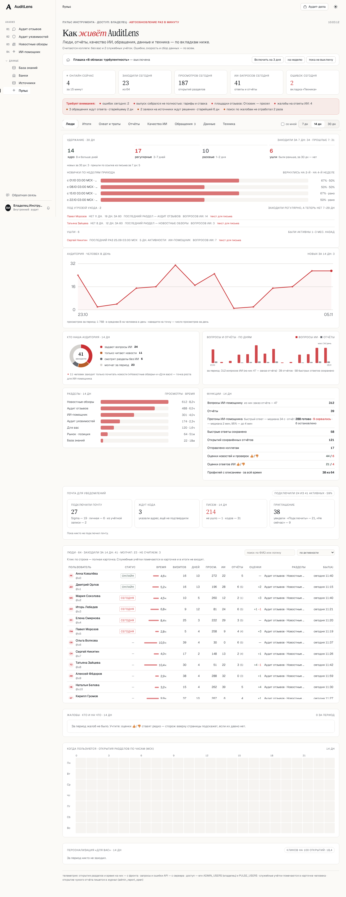
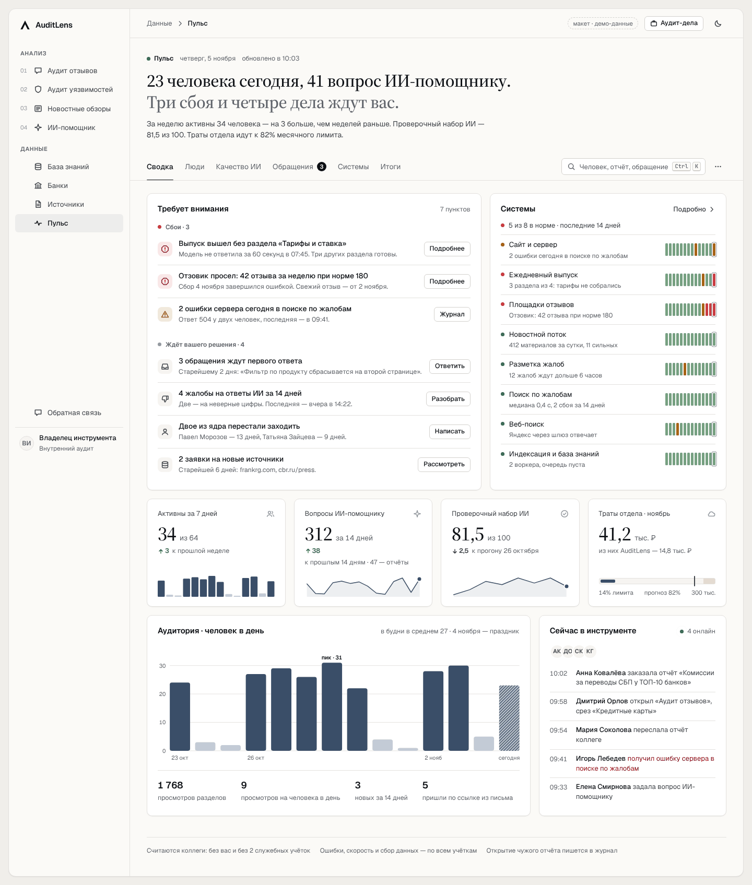

# «Пульс» v2 — макет нового интерфейса

Макет: [`pulse-v2.html`](pulse-v2.html). Это один файл без сборки: откройте его в браузере.
Работают все шесть разделов, карточка человека, поиск `Ctrl+K`, меню «⋯», тёмная тема,
телефон. Цифры демонстрационные. Каждое число привязано к полю, которое сервер уже отдаёт
или должен отдавать (см. «Данные»).

По `DESIGN.md` новый экран начинается с макета, согласованного с владельцем продукта.
Макет согласован и перенесён в приложение: `src/bank_audit/web/static/app.jsx` (блоки
`⟦pu2:…⟧`), новые поля API — `src/bank_audit/web/telemetry.py`, тесты — `tests/test_pulse_v2_*.py`
(браузерные — через стенд `tests/pulse_ui/harness.py` и фикстуры `tests/fixtures/pulse_v2/`).
Адреса разделов в приложении — `#pulse?tab=<раздел>`; старые ключи вкладок по-прежнему работают.

| До | После |
|---|---|
|  |  |

Ещё снимки: [тёмная тема](img/after-overview-dark.png), [«Люди»](img/after-people.png),
[«Итоги» в тёмной теме](img/after-results-dark.png), [телефон](img/after-overview-phone.png).

## Зачем переделывать

Страница выросла из отдельных доработок, каждая добавила свою карточку. Сейчас это:

- **8 вкладок и около 45 блоков.** До первой полезной карточки — шесть слоёв: заголовок,
  пояснение, подпись о том, кого считаем, переключатель плашки, пять плиток и полоса «сторожа».
- **Одни и те же числа в нескольких местах:**
  - вопросы ИИ-помощнику — в 5 местах: плитка «сегодня», «Функции», график по дням,
    плитка и воронка «Итогов», «Вопросы ИИ от штата»;
  - жалобы 👎 — в 4 местах: сторож, «Жалобы · кто и на что», «Оценки ответов ИИ»,
    колонки «оценки»;
  - обращения и заявки на источники — в стороже, на своей вкладке и в «Итогах»;
  - ошибки — в плитке, стороже, «Технике» и живой ленте;
  - четыре таблицы по людям: «Люди», «Почта», «Персонализация „Для вас“», «Готовность
    к персонализации»;
  - две разные сегментации одних и тех же людей: ядро / регулярные / разовые / ушли
    и задают вопросы / читают / смотрят / молчат.
- **Шесть разных периодов.** Глобальные 7/14/30 дней, свой период у «Итогов», удержание
  всегда за 30 дней, площадки за неделю, персонализация за всё время, траты за месяц.
- **Визуальный шум.** Заголовок прописными у каждой карточки, абзац пояснения в каждой
  карточке, таблица на 11 колонок. Нейтральные данные нарисованы красным `--accent`,
  хотя по `DESIGN.md` красный означает только риск. Эмодзи (👍 👎 ✦ ⚑ ✓). Внутренние имена
  на экране: `ADMIN_USERS`, `PULSE_USERS`, `admin_report_open`.

## Принципы нового «Пульса»

1. **Сначала состояние, потом тренды, детали — по запросу.** Страница отвечает по порядку:
   что сломано → что ждёт моего решения → пользуются ли → качество ИИ → итоги для руководства.
2. **Одна фраза-бриф сверху.** «23 человека сегодня, 41 вопрос ИИ-помощнику. Три сбоя
   и четыре дела ждут вас». Фразу собирает шаблон из чисел, без модели: числа считает код
   (главный принцип AuditLens).
3. **Одно число — одно место.** Остальные места ссылаются на него, а не повторяют.
4. **Счётчики вместо процентов на малых выборках.** «4 из 6», а не «67%»: у нас 64 человека,
   когорты по 2–6. Проценты остаются там, где они осмысленны: охват ТБ, траты, лимит.
5. **Цвет — только со смыслом.** Данные — графитовая шкала `--viz`. Красный — сломано,
   жёлтый — требует внимания. Статус всегда дублируется значком или текстом.
6. **Детали — в боковом листе.** Человек, отчёт, диалог, обращение открываются поверх
   страницы, контекст не теряется.
7. **Без шума.** Заголовок карточки — вопрос обычным регистром. Пояснения — в подсказках.
   Без эмодзи и внутренних кодов.

## Структура: 8 вкладок → 6 разделов

Адреса разделов — в хэше (`#overview`, `#people`, `#quality`, `#inbox`, `#systems`,
`#results`): ссылку на раздел можно переслать.

| Раздел | На вопрос | Что внутри |
|---|---|---|
| **Сводка** | Всё ли в порядке и что от меня нужно? | «Требует внимания» двумя группами: «Сбои» и «Ждёт вашего решения», у каждого пункта одна кнопка действия. «Системы» — 8 строк с лентой состояния за 14 дней. Четыре плитки с мини-графиком и сравнением с прошлым периодом. «Аудитория» по дням, «Сейчас в инструменте» |
| **Люди** | Приживается ли инструмент? | «Кто с нами» — точка на человека в 5 сегментах. «Перестали заходить» и «Ушли» с текстом письма. «Новички возвращаются?» — когорты счётчиками. Одна таблица «Все люди» с отборами и активностью за 14 дней. «Разделы», «Когда пользуются», «Почта и персонализация» |
| **Качество ИИ** | Хорошо ли отвечает ИИ? | «Проверочный набор» (ответ и отчёт), «Прогоны», «Оценки ответов» с точками по дням. Что не прошло проверку и история прогонов с моделями. «Жалобы» — ответы ИИ и новости в одной ленте. «Вопросы без шанса на результат» с примерами. «Отчёты и ответы» |
| **Обращения** | Кому ответить? | Список и карточка, как в «Аудите уязвимостей». Шаблоны ответа, статус, контекст страницы, снимки. Отметки «не относится к срезу» — переключателем там же |
| **Системы** | Что сломалось и где? | 8 строк с лентой за 14 дней. Раскрываются в подробности: ошибки, разделы выпуска, площадки, срезы, поиск, индексация. «Скорость ответов сервера». Плашка «В облаках турбулентность» |
| **Итоги** | Что показать руководству? | Свой период: всё время / 90 / 30 / 7 дней. Плитки, **охват по ТБ**, «От вопроса к результату», банки, направления аудита, траты на модели (по дням, моделям и месяцам), обратная связь и дела. «Скачать Excel», «Разметить новые» |

Над разделами — поиск `Ctrl+K`, период 7/14/30 дней и меню «⋯». Период показывается
только в разделах «Люди» и «Качество ИИ», где он действует. В меню: «Считать мои действия»
(было «со мной»), плашка, выгрузка, служебные учётки.

## Куда переехал каждый блок

Ничего содержательного не пропало. Убраны только повторы и пояснения, которые стали подсказками.

| Было | Стало |
|---|---|
| Заголовок «Как живёт AuditLens», пояснение, подпись «считаются коллеги» | Бриф одной фразой. Подпись — в подвале и в меню «⋯» |
| Плашка «Турбулентность» вверху страницы | «Системы» → «Плашка для всех», ссылка в меню «⋯» |
| 5 плиток «сегодня» | Бриф и плитки «Сводки» |
| Сторож «Требует внимания» | «Сводка» → «Требует внимания»: 2 группы, у пункта своя кнопка |
| Люди → Удержание | «Люди» → «Кто с нами», «Перестали заходить», «Ушли», «Новички возвращаются?» |
| Люди → Аудитория · человек в день | «Сводка» → «Аудитория»; вопросы ИИ по дням — в подсказке столбца |
| Люди → Кто наша аудитория (кольцо) | Отборы таблицы «Все люди»: «Задают вопросы ИИ», «Без вопросов ИИ», «Молчат 14 дней» |
| Люди → Вопросы и отчёты по дням | Мини-график плитки «Вопросы ИИ-помощнику» |
| Люди → Разделы, Когда пользуются | «Люди» → «Разделы», «Когда пользуются» |
| Люди → Функции (11 строк) | Разошлись по смыслу: прогоны и оценки → «Качество ИИ», открытия и пересылки → воронка «Итогов» |
| Люди → Почта, Персонализация, Готовность к персонализации | Колонки «Почта» и «Профиль» в «Все люди», строка «Почта и персонализация», подробности — в карточке человека |
| Люди → таблица людей (11 колонок) | «Все люди» (8 колонок). Время, визиты, просмотры, разделы — в карточке человека |
| Люди → Жалобы · кто и на что; Качество ИИ → Оценки ответов ИИ | «Качество ИИ» → «Жалобы» (одна лента) и «Оценки ответов» |
| Итоги → плитки, направления, воронка | «Итоги» |
| Итоги → Качество запросов, запросы без результата | «Качество ИИ» → «Вопросы без шанса на результат» |
| Итоги → Предложения по доработкам и источникам | «Итоги» → «Обратная связь и дела» (счётчики). Списки — в «Обращениях» и «Источниках» |
| **Охват и траты → Охват подразделений (ТБ)** | **«Итоги» → «Охват по территориальным банкам»** — все колонки (штат, пользуются, охват, активны 30 дней, вопросы ИИ, постоянные, часы), итог, разбивка по должностям, «не из штата», «Обновить штат» |
| Охват и траты → Траты на модели | «Итоги» → «Траты на модели»: лимит, прогноз, по дням, по моделям, по месяцам. Плитка — в «Сводке» |
| Отчёты → Что проверяет отдел | «Итоги» → «Какие банки проверяют» |
| Отчёты → Отчёты и ответы | «Качество ИИ» → «Отчёты и ответы» |
| Качество ИИ → Проверочный набор | «Качество ИИ» → карточка, «Что не прошло проверку», «Прогоны» |
| Обращения | «Обращения»: список и карточка |
| Данные → Заявки на источники | Пункт «Ждёт вашего решения» со ссылкой в «Источники» |
| Данные → Площадки, Срезы, Канарейка, Точность сигналов, Выпуск: судья, Поток новостей, Поиск по жалобам, Веб-поиск, Индексация, Сбор | «Системы» — строка на каждую службу, подробности по раскрытию |
| Техника → Скорость, Ошибки, Ежедневный выпуск | «Системы» → «Сайт и сервер», «Ежедневный выпуск», «Скорость ответов сервера» |
| Техника → Живая лента | «Сводка» → «Сейчас в инструменте» |
| Подвал с `ADMIN_USERS`, `PULSE_USERS`, `admin_report_open` | Подвал без внутренних имён |

## Новые элементы

- **Бриф.** Шаблон по `today` и пунктам очереди: «N сбоев и M дел ждут вас», а когда всё
  хорошо — «Всё спокойно». Модель не участвует.
- **Очередь «Требует внимания».** Те же правила, что у `puGuardItems`, разделённые на
  «Сбои» (что сломано у пользователей) и «Ждёт вашего решения» (обращения, жалобы, кого
  вернуть, заявки). Красный — только сбои. Пустая очередь пишет «Всё спокойно».
- **Лента состояния системы за 14 дней** — по образцу страниц статуса: день в норме,
  со сбоями, не работал, нет данных; сегодня обведён.
- **«Кто с нами»** — точка на каждого из 64 человек, по сегментам. Видно, сколько людей
  за процентом, и по клику открывается карточка.
- **Активность за 14 дней в строке человека** — выходные и праздник 4 ноября бледнее.
- **Плитка трат** — линейка лимита: потрачено, зона последних 10%, отметка прогноза.
- **Боковой лист человека** вместо выдвижной панели с шестью вкладками. Сверху цифры,
  ниже по дням, профиль, вопросы и отчёты, разделы. Действия: «Хронология», «Текст письма»,
  «Пометить служебной».
- **Поиск `Ctrl+K`** — люди, обращения, отчёты, разделы. Работает по уже загруженным
  данным.

## Данные: что есть и что нужно добавить в API

Уже отдаёт сервер (`/api/admin/pulse`, `/users`, `/reports`, `/complaints`, `/inbox`,
`/pulse/reach`, `/pulse/costs`, `/pulse/outcomes`, `/agent-eval`, `/pulse/slices`):
всё, кроме пунктов ниже.

Нужно добавить:

1. **История систем по дням** (`systems[].days`, 14 значений «норма / сбои / не работало /
   нет данных»). Выпуск и площадки считаются по существующим таблицам, ошибки — по
   телеметрии. Для очереди индексации нужен ежедневный снимок: её счётчики обнуляются при
   перезапуске.
2. **Активность человека по дням** в `/api/admin/users` (строка из 14 уровней). В карточке
   человека `by_day` уже есть.
3. **Сравнение с прошлым периодом** для плиток: вопросы ИИ за прошлые N дней.
   `active_prev_7d` и `prev` у «Итогов» уже есть.
4. **Оценки ответов по дням** (хорошо / плохо) — агрегат вместо списка `items`.

Охват по ТБ — без изменений API. Подпись колонки — `ORG_UNIT_LABEL=ТБ`. Названия ТБ берутся
из вышестоящего подразделения («… по СЗБ» → «СЗБ»), «Центр» — для строк без номера.

## Визуальные правила

- Токены — дословно из `index.html`. Новые: `--viz`, `--viz-2`, `--viz-3`, `--viz-soft` —
  графитовая шкала для данных в обеих темах. Сейчас нейтральные данные рисуются `--accent`,
  то есть цветом риска. `--canvas` и рамка «окна» нужны только макету.
- Geist — интерфейс, Source Serif 4 — бриф и крупные числа, JetBrains Mono — клавиши.
  Табличные цифры везде, где числа стоят в колонку.
- Заголовок карточки — 15 px, полужирный, обычным регистром. Прописные — только
  у групп меню.
- Основная кнопка — чернильная. Красный — сбой или жалоба. Жёлтый — внимание.
  Зелёный — «в норме» и «онлайн». Сбербанк — `--sber`.
- Без эмодзи: оценки — значками «хорошо» и «плохо», статусы — точкой и словом.

## Адаптивность и доступность

- Ширины из `DESIGN.md`: 1208 и 948 px (окно 1440 и 1180 с меню) и телефон 390 px.
  Горизонтально прокручиваются только вкладки и широкие таблицы.
- До 1280 px сетка 7+5 становится одной колонкой, плитки — 2×2. До 900 px меню
  сворачивается. На телефоне инструменты над вкладками, у графиков своя раскладка.
- Вкладки — `role="tablist"`, стрелки, Home/End. Слои с ловушкой фокуса, `Esc` и
  возвратом фокуса. Подсказки открываются и с клавиатуры. Уважается `prefers-reduced-motion`.

## План внедрения

1. **Каркас без изменений API.** Бриф, 6 разделов, перенос готовых компонентов
   (`PuRetention`, `PuInbox`, `PuOutcomes`, `PuReach`, `PuCosts` и других) по карте выше.
   Токены `--viz`, убрать эмодзи, прописные заголовки и абзацы пояснений.
2. **«Сводка».** Очередь из `puGuardItems` двумя группами, плитки, «Системы» с состоянием
   на сегодня. Лента за 14 дней — после пункта 3.
3. **API.** История систем, активность людей по дням, сравнение с прошлым периодом,
   оценки по дням. Тесты без сети и БД, как в `tests/`.
4. **Слои.** Карточка человека как боковой лист (из `PuUserCard`), просмотр отчёта и
   диалога там же, поиск `Ctrl+K`.
5. **Проверка.** Браузерный тест разделов и хэш-навигации. Нет горизонтальной прокрутки
   на 1208, 948 и 390 px. Обе темы, контраст не ниже 4,5:1.
